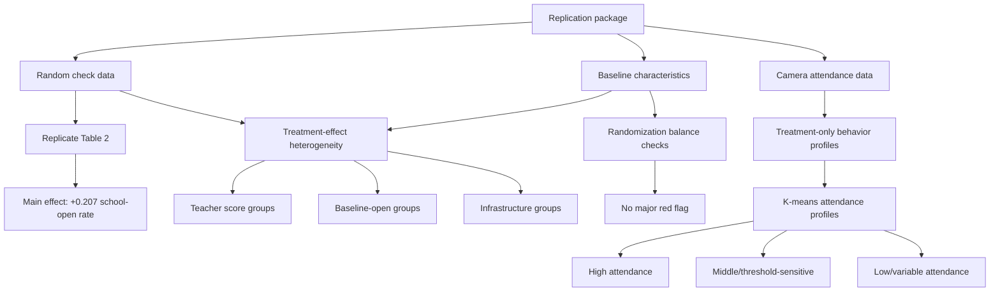
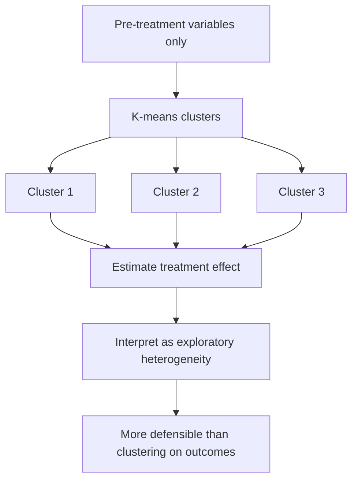
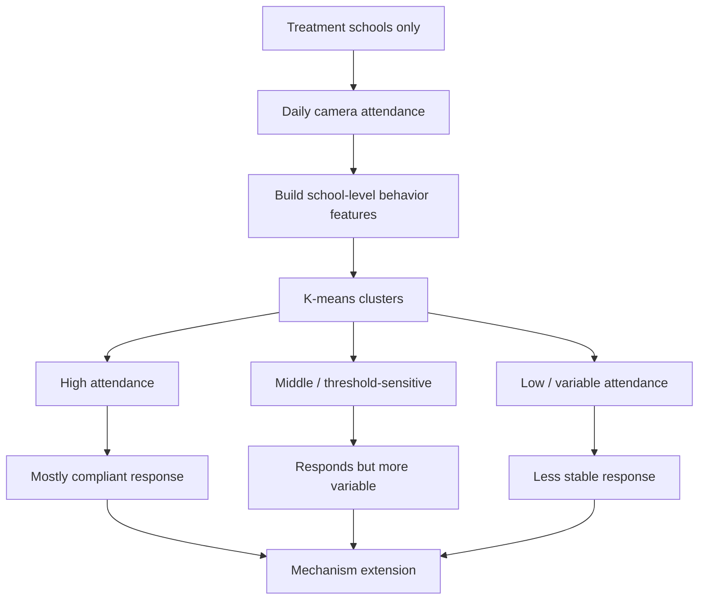
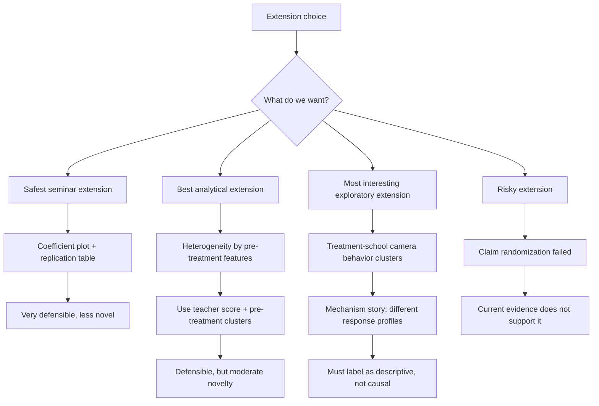

# Exploratory Extension Notes: Duflo, Hanna, and Ryan (2012)

## Main Takeaway

We should not redo the experiment. We should use the replication package to reproduce the main result and then extend it with one transparent exploratory analysis.

After a first pass through the data, the strongest extension direction is not "randomization failed." The balance checks look mostly fine. The stronger direction is:

> The average attendance effect is large and replicates cleanly, but the response is heterogeneous. Some schools and teachers appear to respond much more strongly than others.

This can become a good Track A extension if we keep it careful and honest.

## What We Tried

## Randomization Check

Question:

> Did treatment and control schools look meaningfully different before treatment?

The answer from this first pass is: not strongly. The largest standardized treated-control difference among the checked school-level baseline features is about 0.18, which is modest.

The block counts also look reasonable:

| Block | Control | Treatment |
|---:|---:|---:|
| 1 | 9 | 7 |
| 2 | 12 | 11 |
| 3 | 9 | 11 |
| 4 | 11 | 15 |
| 5 | 15 | 13 |

Important correction: the baseline test data contain negative sentinel values such as `-999`. When those are not cleaned, they produce a false imbalance signal. After cleaning these sentinel values, the balance picture looks much more stable.

Chart:

- `outputs/exploratory/balance_standardized_differences.png`

Conclusion:

> I would not make "the randomization was broken" the extension. It is useful as a validation check, but it is not the strongest paper contribution.

## Heterogeneity Checks

The main replicated attendance effect is:

| Group | Effect | SE | 95% CI |
|---|---:|---:|---:|
| All active schools | 0.207 | 0.030 | 0.149 to 0.265 |
| High teacher-score schools | 0.145 | 0.041 | 0.065 to 0.226 |
| Low teacher-score schools | 0.244 | 0.044 | 0.157 to 0.331 |
| High baseline-open schools | 0.201 | 0.050 | 0.103 to 0.299 |
| Low baseline-open schools | 0.192 | 0.058 | 0.078 to 0.305 |
| High infrastructure schools | 0.218 | 0.045 | 0.129 to 0.306 |
| Low infrastructure schools | 0.191 | 0.039 | 0.115 to 0.267 |

Chart:

- `outputs/exploratory/attendance_effects_by_subgroup.png`

Interpretation:

- The effect is positive in every subgroup.
- The clearest split is teacher baseline score: low-score teachers/schools have a larger estimated treatment effect.
- This is consistent with the original paper, which already reports above- and below-median teacher-score panels. So this alone is not fully new.
- A formal interaction check gives an additional low-score effect of about 0.098 over high-score schools, but the interaction is not conventionally significant at the 5 percent level in this first pass.

## K-Means Option 1: Pre-Treatment School Clusters

This is the safer K-means version because it clusters schools using only pre-treatment variables:

- teacher score
- teacher grade
- infrastructure
- baseline child test performance
- share of children who took the written pretest

Then we estimate the treatment effect separately by cluster.

First-pass results:

| Pre-treatment cluster | Schools | Treated share | Effect | SE |
|---|---:|---:|---:|---:|
| Pre-cluster 1 | 34 | 0.65 | 0.215 | 0.070 |
| Pre-cluster 2 | 37 | 0.41 | 0.160 | 0.053 |
| Pre-cluster 3 | 32 | 0.50 | 0.183 | 0.049 |

Chart:

- `outputs/exploratory/attendance_effects_by_pre_treatment_cluster.png`

Interpretation:

- This is defensible as an exploratory heterogeneity extension.
- It does not produce a dramatic new story yet.
- It may be useful if we can label the clusters in a meaningful way and avoid overclaiming.

## K-Means Option 2: Treatment-School Camera Behavior Profiles

This is descriptively interesting. It uses only the treatment-school camera data and asks:

> Among teachers who received cameras and incentives, were there distinct attendance-response profiles?

Variables used:

- overall workday attendance rate
- early-month attendance rate
- late-month attendance rate
- month-to-month variability
- share of months "in the money"
- share of near-threshold months
- average credited days per month

First-pass cluster summary:

| Camera profile | Schools | Overall work rate | In-money share | Near-threshold share | Avg credited days |
|---|---:|---:|---:|---:|---:|
| High attendance | 32 | 0.784 | 0.982 | 0.008 | 22.79 |
| Middle/threshold-sensitive | 22 | 0.668 | 0.907 | 0.030 | 19.83 |
| Low/variable attendance | 10 | 0.440 | 0.681 | 0.111 | 14.74 |

Chart:

- `outputs/exploratory/camera_cluster_monthly_profiles.png`

Interpretation:

- This is the most interesting "play with the data" result.
- It cannot prove a causal subgroup effect because all these schools are treated and the clusters use post-treatment behavior.
- But it can extend the paper mechanistically: the treatment did not produce one uniform response. Roughly half the observed treatment-school IDs are high-attendance, while a smaller group remains low and variable.

## Best Extension Choices

## Recommended Direction

Use a two-part extension:

1. Main extension: coefficient plot of the replicated attendance effect by period and teacher-score subgroup.
2. Exploratory add-on: treatment-school camera behavior profiles using K-means.

This gives us a safe core and an interesting original contribution.

Proposed one-sentence paper contribution:

> I replicate Duflo, Hanna, and Ryan's main attendance result and show evidence consistent with response heterogeneity: the treatment effect is larger in point estimate among lower baseline teacher-score schools, and treatment-school camera data reveal distinct high-attendance, middle, and low/variable response profiles.

## What To Avoid

- Do not claim K-means proves causal mechanisms.
- Do not cluster on post-treatment outcomes and then estimate causal treatment effects by those clusters.
- Do not claim randomization failed unless a stronger balance or assignment test supports it.
- Do not run many subgroup tests and only report the most exciting one without saying the analysis is exploratory.
- Do not replace the simple replication with a black-box model. The seminar asks for replication plus one sensible extension, not a machine-learning paper.

## Reproducibility Files

Script:

- `scripts/explore_track_a_extensions.py`

Outputs:

- `outputs/exploratory/randomization_balance_school_level.csv`
- `outputs/exploratory/randomization_block_counts.csv`
- `outputs/exploratory/attendance_effects_by_subgroup.csv`
- `outputs/exploratory/pre_treatment_school_clusters_summary.csv`
- `outputs/exploratory/attendance_effects_by_pre_treatment_cluster.csv`
- `outputs/exploratory/camera_behavior_clusters_summary.csv`
- `outputs/exploratory/camera_behavior_school_features.csv`
- `outputs/exploratory/balance_standardized_differences.png`
- `outputs/exploratory/attendance_effects_by_subgroup.png`
- `outputs/exploratory/attendance_effects_by_pre_treatment_cluster.png`
- `outputs/exploratory/camera_cluster_monthly_profiles.png`
