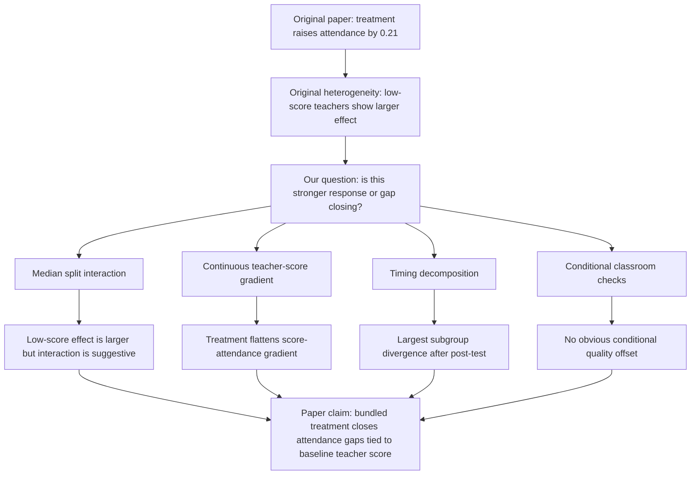

# Teacher-Score Heterogeneity Extension Memo

## Working Paper Question

**Do monitoring and incentives close attendance gaps among lower-scoring teachers?**

This is a strong Track A extension because it starts from an original result in Duflo, Hanna, and Ryan (2012), then adds a clearer interpretation using the replication data. The paper already shows that the attendance effect is larger for teachers with below-median baseline test scores. Our extension asks whether this is best understood as:

1. a simple "low-score teachers respond more" result, or
2. a gap-closing result where treatment flattens the relationship between baseline teacher score and attendance.

The data support the second interpretation more strongly.

## Anchor In The Original Paper

The original Table 2 splits the attendance effect by teacher baseline test score:

| Group in original Table 2 | Effect on school open during random check |
|---|---:|
| All teachers | 0.21 |
| Above-median teacher test score | 0.15 |
| Below-median teacher test score | 0.24 |

The original Stata file constructs this split directly:

```stata
gen score=comp1+comp2+comp3+clozet+story+attitude+nnc1+nc1+nc2+nnc2+nnc3+nc3+vp+map
egen med_score=median(score)
gen above_score=0
replace above_score=1 if score>=med_score
```

The paper states that the effect was larger for below-median teachers, but also notes that the program brought below-median teachers to the same attendance level as above-median teachers, about 78 percent.

## Treatment Variable We Can Actually Study

The reduced-form random-check data identify one treatment contrast:

| Group | Monitoring | Pay incentives | What we can estimate |
|---|---|---|---|
| Control schools | No daily camera attendance monitoring | Flat monthly pay | Baseline comparison |
| Treatment schools | Daily camera photos | Attendance-linked pay | Bundled camera-plus-incentive effect |

This means the clean attendance estimates below are **not** separate camera-only and incentive-only effects. They estimate the effect of receiving both the monitoring technology and the attendance-based salary rule. The original paper uses the treatment-school camera/payroll data and a structural model to learn more about financial incentives, but the randomized treatment indicator itself does not contain separate treatment arms.

## What We Add

Instead of only repeating the above/below median subgroup table, we add seven manipulations of the same replication data:

1. **Reproduce the original median split**: high-score vs low-score teacher groups.
2. **Estimate a formal interaction model**: treatment, low-score status, and treatment x low-score.
3. **Use continuous teacher score**: z-score teacher test score and estimate treatment x teacher-score gradient.
4. **Decompose the gap-closing result**: compare high-minus-low attendance gaps in control and treatment schools.
5. **Use score quartiles as a noise filter**: avoid over-reading exact teacher-score cells with only a few schools.
6. **Split by time period**: before mid-test, mid-test to post-test, and after post-test.
7. **Check conditional classroom measures**: among open schools, test whether treatment lowered observed teaching behavior for low-score teachers.

## Main Results From Current Data

The replication subset with non-missing teacher scores has 2,927 observations and 107 schools.

| Quantity | Estimate |
|---|---:|
| High-score teacher treatment effect | 0.145 |
| Low-score teacher treatment effect | 0.244 |
| Low minus high interaction | 0.098 |
| Interaction p-value | 0.105 |
| Control high-minus-low attendance gap | 0.100 |
| Treatment high-minus-low attendance gap | 0.002 |
| Share of control gap closed | 0.982 |
| Continuous treatment x score interaction, time + block FE | -0.048 |
| Continuous interaction p-value | 0.060 |

Interpretation: both score groups respond to the bundled treatment. The low-score effect is larger in point estimate, but the binary low-vs-high treatment-effect difference is suggestive rather than conventionally significant at 5 percent. The more interesting and more defensible result is gap closing: control schools have a 10.0 percentage point attendance gap between high-score and low-score teachers, while treatment schools have almost no high-low gap.

## Signal Versus Noise

| Finding | Status | Why |
|---|---|---|
| Bundled treatment raises attendance for both teacher-score groups | Strong | High-score effect is +14.5 pp and low-score effect is +24.4 pp; both are precisely positive. |
| Low-score teachers have a larger point-estimate treatment effect | Suggestive | Difference is +9.8 pp, but binary interaction p-value is 0.105. |
| Treatment closes the score-attendance gap | Stronger | Control high-minus-low gap is +10.0 pp; treatment high-minus-low gap is +0.2 pp. |
| Attendance depends on teacher score in control schools | Strong | School-level control slope is +8.4 pp per teacher-score SD, p = 0.001. |
| Treatment flattens that score gradient | Stronger extension result | Treatment x score slope is -6.9 pp, p = 0.026; treatment slope is only +1.5 pp, p = 0.431. |
| Top score quartile responds less than lower quartiles | Descriptive/suggestive | Quartile estimates decline in the top quartile, but quartile CIs overlap. |
| Camera-only vs incentive-only effect | Not identified here | The randomized treatment bundles monitoring and incentives. |

## The Catch-Up Pattern

| Teacher score group | Control open rate | Treatment open rate | Treatment effect |
|---|---:|---:|---:|
| High score | 0.634 | 0.779 | 0.145 |
| Low score | 0.534 | 0.778 | 0.244 |

This is the key paper insight: treatment does **not** make low-score teachers outperform high-score teachers. It makes low-score treated schools catch up to high-score treated schools. The larger low-score treatment effect is mainly because low-score control schools have much lower attendance.

The formal decomposition is:

| Quantity | Estimate | p-value |
|---|---:|---:|
| High-score treatment effect | 0.145 | 0.001 |
| Low-score treatment effect | 0.244 | <0.001 |
| Low-minus-high treatment-effect difference | 0.098 | 0.105 |
| Control high-minus-low attendance gap | 0.100 | 0.026 |
| Treatment high-minus-low attendance gap | 0.002 | 0.966 |
| Share of control gap closed | 0.982 | n/a |

The p-value pattern matters. The exact low-vs-high treatment-effect difference is noisy, but the disappearance of the high-low attendance gap under treatment is very clear descriptively and consistent with the gradient model.

## Randomization Check

This does not look like a randomization-failure story.

| Balance outcome | Control mean | Treatment mean | Difference | p-value |
|---|---:|---:|---:|---:|
| Baseline teacher score | 33.55 | 34.99 | 1.44 | 0.478 |
| Below-median-score share | 0.556 | 0.434 | -0.122 | 0.212 |

If anything, treatment schools have slightly higher teacher scores and fewer low-score teachers. That pattern does not mechanically explain why the estimated treatment effect is larger among low-score teachers.

Teacher-score distributions by randomized group:

| Treatment group | Schools | Mean score | Median | IQR | Min | Max | Below-median share |
|---|---:|---:|---:|---:|---:|---:|---:|
| Control | 54 | 33.55 | 33.0 | 27.0-40.0 | 11.0 | 55.0 | 0.556 |
| Treatment | 53 | 34.99 | 38.0 | 27.0-42.0 | 3.0 | 53.0 | 0.434 |

This is useful for the paper because it says the treatment group was not stacked with weaker teachers. If anything, treatment schools look slightly stronger on baseline teacher score.

## Gradient Result

At the school level, control schools show a strong positive relationship between teacher score and attendance:

| Term | Estimate | p-value |
|---|---:|---:|
| Control score slope | 0.084 | 0.001 |
| Treatment x score interaction | -0.069 | 0.026 |
| Implied treatment score slope | 0.015 | 0.431 |

Interpretation: in control schools, higher teacher score predicts higher attendance. In treatment schools, that relationship nearly disappears. This is the cleanest extension result.

## Score Quartile Result

Exact teacher-score cells are too sparse to interpret school-by-school score effects. Many exact scores appear in only one to three schools. Quartiles are a better noise filter.

| Teacher-score band | Score range | Treatment effect | 95% CI | Control schools | Treatment schools |
|---|---:|---:|---:|---:|---:|
| Q1 lowest scores | 3-27 | 0.238 | 0.131 to 0.344 | 16 | 14 |
| Q2 | 28-37 | 0.239 | 0.104 to 0.374 | 16 | 10 |
| Q3 | 37.5-41.5 | 0.219 | 0.089 to 0.349 | 9 | 15 |
| Q4 highest scores | 42-55 | 0.098 | -0.014 to 0.209 | 13 | 14 |

Interpretation: the strongest stable pattern is not "only low-score teachers respond." The first three quartiles all show large positive effects. The top quartile has the smallest estimate and the widest practical uncertainty around whether the effect is large. This supports the broader gradient-flattening story more than a sharp median cutoff story.

## Timing Result

| Period | High-score effect | Low-score effect | Low minus high |
|---|---:|---:|---:|
| Until mid-test | 0.148 | 0.210 | 0.062 |
| Mid-test to post-test | 0.146 | 0.144 | -0.002 |
| After post-test | 0.143 | 0.315 | 0.172 |

The subgroup divergence is largest after the post-test. This can become a useful discussion point: the treatment effect among high-score teachers is stable, while the low-score effect becomes especially large later.

## Conditional Classroom Behavior

Among schools that were open during random checks, there is no clear evidence that treatment made low-score teachers visibly reduce classroom effort:

| Outcome, conditional on open | Low-score treatment effect |
|---|---:|
| Teacher inside school | -0.010 |
| Blackboard used | 0.021 |
| Interacting with kids | -0.003 |
| Number of students | 0.787 |

Caution: these are conditional-on-open outcomes, so they are descriptive rather than causal. Still, they are useful because they do not show an obvious "attendance increased but classroom behavior collapsed" pattern.

## Visual Roadmap



## Paper Claim We Can Defend

The safest claim:

> The bundled camera-plus-incentive program appears to close attendance gaps associated with baseline teacher skill. In control schools, lower teacher scores are associated with lower attendance. Under treatment, low-score teachers reach almost the same attendance rate as high-score treated teachers, and the school-level teacher-score attendance gradient becomes nearly flat.

Claims to avoid:

1. Do not claim low-score teachers are the only group affected. High-score teachers also respond.
2. Do not claim the subgroup interaction is definitively significant in every specification. The binary split is suggestive.
3. Do not claim teacher score is a perfect measure of teacher quality. It is a baseline teacher-test score from the original paper.
4. Do not claim the randomization failed. The score-balance check does not support that.
5. Do not claim conditional classroom outcomes are causal treatment effects on pedagogy.
6. Do not claim the reduced-form experiment separately identifies monitoring-only and incentive-only effects.

## Recommended Paper Structure

1. **Introduction**: Replicate Duflo, Hanna, and Ryan and extend the analysis to ask whether the bundled monitoring-plus-incentive treatment closes attendance gaps among lower-scoring teachers.
2. **Original experiment and data**: Explain treatment, random checks, teacher-score measure, and original Table 2.
3. **Replication**: Show main 0.21 attendance effect and original above/below median teacher-score split.
4. **Extension methods**: Explain median split interaction, continuous score interaction, school-level gradient model, time periods, and conditional classroom checks.
5. **Extension results**: Lead with catch-up means, gap-closing decomposition, and gradient figure.
6. **Discussion**: The bundled treatment is not just raising average attendance; it weakens the link between lower baseline teacher score and absenteeism.
7. **Limitations**: Exploratory heterogeneity, multiple testing, teacher score proxy, conditional outcomes.

## Files Produced

- Analysis script: `scripts/teacher_score_extension.py`
- Output folder: `outputs/teacher_score_extension/`
- Main figure: `outputs/teacher_score_extension/teacher_score_attendance_gradient.png`
- Catch-up figure: `outputs/teacher_score_extension/teacher_score_catchup_open_rates.png`
- Quartile figure: `outputs/teacher_score_extension/teacher_score_quartile_effects.png`
- Timing figure: `outputs/teacher_score_extension/teacher_score_period_effects.png`
- Continuous marginal effects figure: `outputs/teacher_score_extension/teacher_score_marginal_effects.png`
- Main summary table: `outputs/teacher_score_extension/teacher_score_extension_summary.csv`
- Gap-closing decomposition: `outputs/teacher_score_extension/teacher_score_gap_closing_decomposition.csv`
- Teacher-score distribution by group: `outputs/teacher_score_extension/teacher_score_distribution_by_treatment.csv`
- Teacher-score quartile effects: `outputs/teacher_score_extension/teacher_score_quartile_effects.csv`
- Balance table: `outputs/teacher_score_extension/teacher_score_randomization_balance.csv`
- School gradient model: `outputs/teacher_score_extension/school_level_score_gradient_model.csv`
